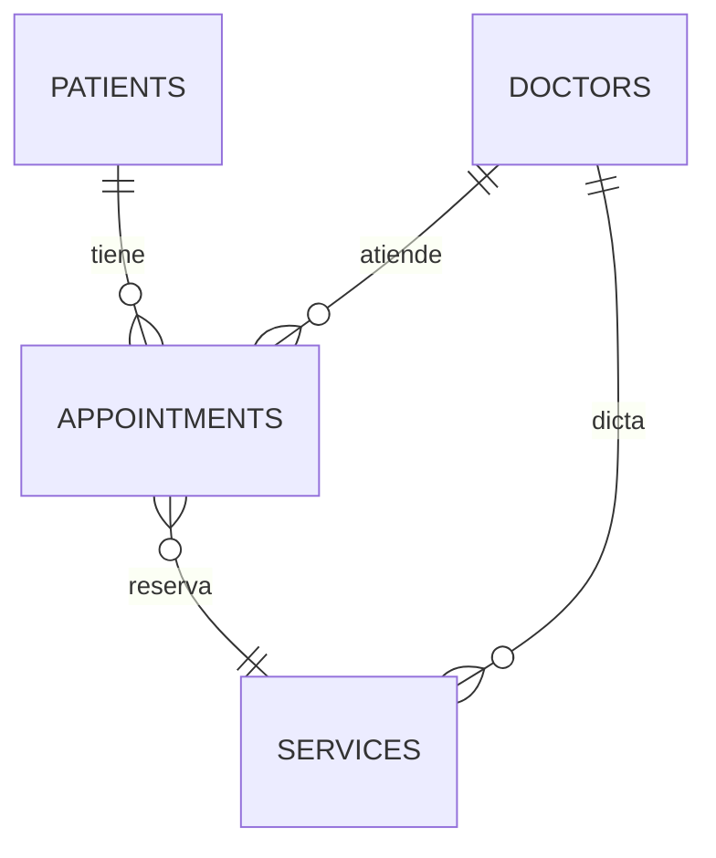

# Diseño de base de datos — PostgreSQL

Estado: **propuesta** (ver [README](README.md)). Stack asumido: Spring Boot +
Spring Data JPA + Flyway. Fuente de negocio: la demo de
`client/src/app/page.tsx`.

## Diagrama



Lo único de la demo que no se modela como tabla: los `initials`/`color` y el
count de visitas se **calculan** (COUNT sobre appointments), igual que el
balance de la ficha (SUM de pagos pendientes).

## Tablas

### `patients`
| Columna | Tipo | Notas |
|---|---|---|
| id | BIGSERIAL PK | |
| full_name | VARCHAR(120) NOT NULL | |
| email | VARCHAR(140) | para confirmaciones/recordatorios |
| phone | VARCHAR(40) | |
| birth_date | DATE | |
| admin_notes | TEXT | notas de gestión; NO es historia clínica |
| created_at / updated_at | TIMESTAMPTZ NOT NULL | |

Índice: `bio_idx = lower(full_name)` parcial o trigram + índices en `email`,
`phone` para la búsqueda de la tabla de pacientes.

### `doctors`
| Columna | Tipo | Notas |
|---|---|---|
| id | BIGSERIAL PK | |
| full_name | VARCHAR(120) NOT NULL | ej. "Dra. Valentina Ríos" |
| specialization | VARCHAR(80) | Clínica médica, Cardiología… |
| schedule_hours | JSONB o REC slot/horario | pendiente CRUD de disponibilidad |
| active | BOOLEAN NOT NULL DEFAULT true | "borrar" un profesional = licencia, no DELETE |
| created_at / updated_at | TIMESTAMPTZ NOT NULL | |

En la demo los horarios están hardcodeados por doctor. Se agregan como campos
de texto hasta que un plan defina disponibilidad granular.

### `services`
| Columna | Tipo | Notas |
|---|---|---|
| id | BIGSERIAL PK | |
| name | VARCHAR(100) NOT NULL | |
| doctor_id | BIGINT FK → doctors | |
| duration_minutes | SMALLINT NOT NULL CHECK (duration_minutes > 0) | |
| price | NUMERIC(10,2) NOT NULL CHECK (price >= 0) | |
| visible | BOOLEAN NOT NULL DEFAULT true | toggle del catálogo |
| created_at / updated_at | TIMESTAMPTZ NOT NULL | |

Índice: `(doctor_id, name)` UNIQUE.

### `appointments`
| Columna | Tipo | Notas |
|---|---|---|
| id | BIGSERIAL PK | |
| patient_id | BIGINT FK → patients | ON DELETE RESTRICT |
| doctor_id | BIGINT FK → doctors | ON DELETE RESTRICT |
| service_id | BIGINT FK → services | |
| appointment_date | DATE NOT NULL | |
| start_time | TIME NOT NULL | |
| duration_minutes | SMALLINT NOT NULL | snapshot del service (el precio cambia; el turno no) |
| price | NUMERIC(10,2) NOT NULL | snapshot del service |
| status | turno_status NOT NULL DEFAULT 'pendiente' | ver enum |
| payment_status | pago_status NOT NULL DEFAULT 'pendiente' | ver enum |
| cancel_reason | VARCHAR(255) | NOT NULL si status='cancelada' (CHECK) |
| created_at / updated_at | TIMESTAMPTZ NOT NULL | |

Enums nativos de Postgres (o lookup table si el equipo lo prefiere):

```
turno_status : pendiente | confirmada | atendida | cancelada | no_asistio
pago_status  : pendiente | pagado
```

Índices:

- `UNIQUE (doctor_id, appointment_date, start_time)`
  `WHERE status NOT IN ('cancelada', 'no_asistio')` — es la regla 1 del
  contrato de API (*turno únicamente por profesional/horario activo*).
- `(patient_id, appointment_date DESC)` — historial y últimos turnos del día.
- `(appointment_date, status)` — panel del día (`Agenda`).

## Notas de diseño

- **Snapshot de precio/duración en el turno**: si mañana cambia el precio del
  servicio, los turnos ya agendados conservan su valor (la demo así lo asume).
- Las reglas de agenda (conflicto, slot pasado) viven **el backend**, no solo en
  la BD; los índices/la CHECK de cancel_reason son el último recurso.
- No hay users/roles acá porque la autenticación es un plan separado; el
  vínculo es el doctor/recepcionista, decisión pendiente.
- `updated_at` con trigger común a las 4 tablas (o `@UpdateTimestamp` de JPA si
  el equipo lo prefiere ahí).
